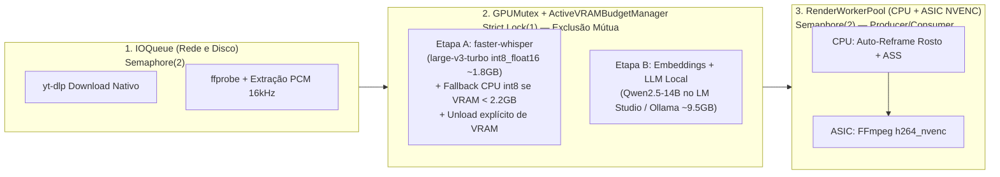

# ARCHITECTURE.md — Arquitetura do Sistema e Desenho Técnico do Motor Local de IA

> [!IMPORTANT]
> Este documento especifica a arquitetura interna, algoritmos de IA/DSP, gerenciamento de concorrência de hardware, tratamento de casos de borda e persistência em arquivos do novo **Backend em Python (`FastAPI`)** do **YouTube Shorts Local AI Studio**.
> Todo o sistema foi projetado sob a premissa **100% Local e Custo Zero**, calibrado para o hardware de referência **NVIDIA RTX 5070 (12 GB GDDR7, Blackwell, NVENC 9ª Geração) + 32 GB RAM DDR4 3200MHz**.

---

## 1. Visão Geral da Arquitetura (Hexagonal / Clean Architecture)

O backend adota **Hexagonal Architecture (Ports & Adapters)** em Python 3.11+, separando estritamente a camada de transporte HTTP (`FastAPI`), a orquestração de casos de uso (`Application Services`), o núcleo algorítmico de domínio (`Domain Pipeline`) e os adaptadores de infraestrutura (`Infrastructure Adapters`: GPU/VRAM Manager, `faster-whisper`, `Silero VAD`, `LM Studio / Ollama`, `OpenCV / MediaPipe`, `FFmpeg NVENC` e `Atomic File Storage`).

```mermaid
flowchart TB
    subgraph API["Camada de Apresentação (app/api)"]
        R_JOBS["routers/jobs.py"]
        R_VIDEOS["routers/videos.py"]
        R_MEDIA["routers/media.py"]
        R_CONFIG["routers/config.py"]
    end

    subgraph APP["Camada de Aplicação e Concorrência (app/application)"]
        ORCH["PipelineOrchestrator\n(Single-Job & Batch Runner)"]
        SCHED["HardwareResourceScheduler\n(IOQueue | GPUMutex + VRAMBudgetManager | RenderWorkerPool)"]
        RUNTIME["OperationRuntimeService\n(Ring-Buffer Logs, Cancel Tokens, Process Trees)"]
    end

    subgraph DOMAIN["Núcleo de Domínio e Algoritmos (app/domain)"]
        S1["1. Ingest & Media Probe"]
        S2["2. GPU Transcription + VAD + Chunked Acoustic DSP"]
        S3["3. Discourse Semantic Blocks + Contextual TextTiling"]
        S4["4. 3-Phase Narrative Arc Mining + Top-K Lookaround"]
        S5["5. Non-Causal Virtual Cameraman (9:16) + ASS Captions"]
    end

    subgraph INFRA["Camada de Infraestrutura / Adapters (app/infrastructure)"]
        A_YTDLP["YtDlpNativeAdapter\n(import yt_dlp + ffprobe)"]
        A_WHISPER["FasterWhisperAdapter\n(CTranslate2 int8_float16 + Silero VAD)"]
        A_LLM["UnifiedLocalLLMAdapter\n(LM Studio :1234/v1 & Ollama :11434)"]
        A_VISION["MediaPipeVisionAdapter\n(Face Tracking + HSV Scene Cut + Active Speaker)"]
        A_FFMPEG["FFmpegNvencAdapter\n(-filter_complex_script + h264_nvenc + libx264 fallback)"]
        A_STORE["AtomicJsonArtifactStore\n(data/jobs/<id>/ & {video_dir}/transcrições/)"]
    end

    API --> APP
    APP --> DOMAIN
    DOMAIN --> INFRA
```



### 1.1 Estrutura de Diretórios do Backend Python (`backend/`)

```text
backend/
├── pyproject.toml                   # Dependências Python (FastAPI, faster-whisper, opencv, mediapipe, yt-dlp, numpy, scipy, httpx)
├── app/
│   ├── main.py                      # Entrypoint FastAPI + Lifespan + CORS + Media Streaming
│   ├── core/
│   │   ├── config.py                # Defaults calibrados (qwen2.5:14b, large-v3-turbo, h264_nvenc)
│   │   ├── paths.py                 # Resolução determinística e cross-OS de caminhos (data/, uploads/, _archived/)
│   │   ├── settings.py              # Leitura/escrita atômica de data/settings.json com normalização Windows/POSIX
│   │   └── tool_configs.py          # Leitura/escrita atômica de default_configs.json e custom_settings.json
│   ├── models/
│   │   ├── domain.py                # Modelos Pydantic v2 (Job, Segment, WordTiming, SemanticBlock, TopicSegment, Cut)
│   │   └── schemas.py               # DTOs de Request/Response compatíveis com shared/contracts.ts
│   ├── api/
│   │   ├── routers/
│   │   │   ├── health.py
│   │   │   ├── jobs.py              # Rotas /jobs/* e /jobs/batch/*
│   │   │   ├── videos.py            # Rotas /videos/*
│   │   │   ├── media.py             # Streaming HTTP Range 206 (/media/*)
│   │   │   └── config.py            # Rotas /config/* (LM Studio + Ollama, tool-configs, dependencies)
│   ├── application/
│   │   ├── scheduler.py             # HardwareResourceScheduler + ActiveVRAMBudgetManager
│   │   ├── runtime_service.py       # Logs em memória (400 linhas), cancel_tokens cooperativos e sessões de instalação
│   │   ├── job_lifecycle.py         # Transições de estado e invalidação de cache
│   │   └── orchestrator.py          # Execução sequencial com checkpointing por etapa
│   ├── domain/
│   │   ├── ingest/                  # Extração de metadados, chapters do YouTube e áudio PCM 16kHz
│   │   ├── transcription/           # VAD, filtro anti-alucinação, diarização acústica em chunks e word alignment
│   │   ├── segmentation/            # Marcadores de discurso PT/EN + TextTiling contextual com Depth Score
│   │   ├── analysis/                # Mineração de arco narrativo (3 fases) + Top-K Lookaround + Snap RMS/Zero-Crossing
│   │   └── rendering/               # Cinegrafista Virtual 9:16 (Savitzky-Golay + RDP) + Gerador ASS + FFmpeg NVENC
│   └── infrastructure/
│       ├── storage/                 # AtomicJsonArtifactStore (escrita .tmp + os.replace)
│       ├── llm/                     # Cliente unificado LM Studio (OpenAI v1) + Ollama (/api/chat, /api/embed)
│       ├── audio/                   # Extrator PCM 16kHz, cálculo de energia RMS (10ms) e MFCC speaker shifts em chunks
│       ├── vision/                  # Detector facial MediaPipe/YuNet, Active Speaker e detector de corte de cena HSV
│       └── video/                   # Construtor de -filter_complex_script e executor FFmpeg NVENC / libx264
└── tests/                           # Suíte pytest cobrindo contratos de rota, pipeline e algoritmos
```

---

## 2. Gerenciamento de Concorrência, Coexistência de VRAM e Cancelamento

Na arquitetura física da **RTX 5070 (12 GB GDDR7) + 32 GB RAM**, diferentes motores físicos operam de forma independente. Para evitar **CUDA Out-Of-Memory (OOM)** sem desperdiçar CPU, rede ou o chip dedicado **NVENC**, o backend utiliza **Pipelining Isolado por Recurso de Hardware** combinado com um **Gerenciador Ativo de Orçamento de VRAM (`ActiveVRAMBudgetManager`)**:



### 2.1 Coexistência de VRAM na RTX 5070 (12 GB) (`ActiveVRAMBudgetManager`)
Em uma RTX 5070 de 12 GB, o sistema operacional + navegador consomem ~1.2 GB, restando **~10.8 GB de VRAM útil**. Como o usuário pode estar com o **`qwen2.5:14b` (~9.5 GB VRAM)** carregado em um processo externo (**LM Studio** ou **Ollama**), o `ActiveVRAMBudgetManager` aplica o seguinte protocolo determinístico:

1. **Inspeção Pré-Alocação para o `faster-whisper` (Requisito: $\ge 2.2\text{ GB}$ de VRAM livre):**
   - Antes de carregar o `faster-whisper` em `cuda` (`compute_type="int8_float16"`, ~1.8 GB VRAM), o sistema consulta a VRAM livre via `torch.cuda.mem_get_info()` / `nvidia-smi`.
   - Se a VRAM livre for $< 2.2\text{ GB}$:
     1. Verifica se o **Ollama** possui modelos carregados em `GET /api/ps` e envia automaticamente `POST /api/generate {"model": "<name>", "keep_alive": 0}` para liberar a VRAM.
     2. Tenta `lms unload --all` caso a CLI do LM Studio esteja no `PATH` e ociosa.
     3. Reavalia a VRAM livre. Se ainda for $< 2.2\text{ GB}$ (ex: modelo de 14B travado manualmente pelo usuário no LM Studio), o `FasterWhisperAdapter` faz **fallback automático e transparente para `device="cpu", compute_type="int8", cpu_threads=8`** (aproveitando os 32 GB de RAM DDR4 sem falhar o Job!).
2. **Limpeza Determinística Pós-Transcrição:**
   - Sempre dentro de um bloco `try ... finally:` protegido pelo `GPUMutex`:
     ```python
     del whisper_model
     gc.collect()
     if torch.cuda.is_available():
         torch.cuda.empty_cache()
     ```
3. **Prevenção de *Model Thrashing* entre Embeddings (`nomic-embed-text`) e LLM (`qwen2.5:14b`):**
   - Na etapa de TextTiling (Estágio 3), ao chamar `nomic-embed-text` no Ollama (`/api/embed`), o backend envia `options={"num_gpu": 0}` (executando os embeddings de ~100 blocos na CPU em $< 0.8\text{s}$) ou `keep_alive: 0` antes de iniciar a Fase 4A, evitando que o servidor descarregue o modelo de 14B da VRAM apenas para calcular embeddings leves.

### 2.2 Protocolo de Cancelamento Cooperativo e Limpeza sem Processos Órfãos
Para garantir que `POST /jobs/:id/transcribe/cancel`, `POST /jobs/:id/render/cancel` e `POST /jobs/batch/:batch_id/cancel` respondam instantaneamente sem deixar locks presos no `GPUMutex` ou arquivos corrompidos:

1. **Cancelamento Cooperativo no `faster-whisper` (`< 500ms`):**
   - `model.transcribe()` em `faster-whisper` retorna um generator lazy `segments_gen`. O loop de consumo verifica `if cancel_token.is_set(): segments_gen.close(); raise OperationCancelledError()` a cada segmento decodificado. O bloco `finally:` descarrega o modelo da VRAM, libera o `GPUMutex` imediatamente e restaura `job.status = "DOWNLOADED"`.
2. **Cancelamento de Renderização e Limpeza de `.mp4` Parciais:**
   - Ao cancelar uma renderização, o `cancel_token` interrompe o loop de visão computacional (`OpenCV`/`MediaPipe`), encerra toda a árvore de subprocessos FFmpeg ativos (`taskkill /T /F /PID` no Windows / `os.killpg` no Linux) e **deleta imediatamente do disco quaisquer arquivos `.mp4`, `.ass` e `filter_script.txt` incompletos** que estavam em escrita.
3. **Cascata de Cancelamento no Batch (`POST /jobs/batch/:batch_id/cancel`):**
   - Além de marcar `progress.is_running = False`, aciona imediatamente o `cancel_token` do `current_job_id` em execução — cancelando a transcrição ativa, fechando o socket TCP `httpx` com o LM Studio / Ollama (para abortar a geração de tokens na GPU na mesma hora) ou matando a renderização em andamento.

---

## 3. Pipeline Algorítmico de Ponta a Ponta (5 Estágios)

### Estágio 1: Ingestão Nativa, Probing e Âncoras de Capítulos (`domain/ingest`)
1. **Download via Biblioteca `yt_dlp`:**
   - Importa `yt_dlp.YoutubeDL` diretamente no Python, capturando hooks de progresso reais (`downloaded_bytes`, `total_bytes`, `speed`, `eta`) para alimentar `GET /jobs/:id/logs/ingest`.
   - Caso o seletor de formato principal (`bv*[height<=1080]+ba/b[height<=1080]`) falhe em algum vídeo específico, tenta fallback automático para `"bestvideo+bestaudio/best"` antes de reportar erro real. **Nunca cria vídeos MP4 falsos (dummy) silenciosamente.**
2. **Extração Garantida de Duração (`video_duration_seconds`) e Capítulos (`chapters`):**
   - Tanto no download do YouTube (via `info_dict["duration"]` e `ffprobe`) quanto no upload local (`POST /jobs/upload` via `ffprobe`), o campo `job.video_duration_seconds` é **sempre** preenchido e salvo em `job.json`.
   - Se o vídeo do YouTube possuir `chapters` marcados pelo criador, eles são persistidos em `source.info.json` como **fronteiras âncora de alta confiança**.
3. **Extração Acústica Base:**
   - Extrai um arquivo temporário `audio_16k.wav` (PCM 16-bit, 16kHz, mono) em `{video_dir}/transcrições/` para consumo imediato pelo VAD, Whisper e analisador de energia RMS.

---

### Estágio 2: Transcrição GPU Word-Level, VAD, Anti-Alucinação e Prosódia em Chunks (`domain/transcription`)
1. **Inferência `faster-whisper` (`large-v3-turbo`) + `Silero VAD`:**
   - Executa com `vad_filter=True` (`min_silence_duration_ms=400`, `speech_pad_ms=200`) e `word_timestamps=True`.
   - Ordem de fallback automático: `faster-whisper (cuda int8_float16)` $\rightarrow$ `faster-whisper (cpu int8)` $\rightarrow$ `openai-whisper CLI`.
2. **Filtro Pós-Transcrição Anti-Alucinação:**
   - Descarta segmentos gerados sobre música/vinheta que apresentem `no_speech_prob > 0.65` combinado com `avg_logprob < -1.0`, `compression_ratio > 2.4` (repetição em loop) ou assinaturas clássicas de alucinação em silêncio (*"Legendas pela comunidade Amara.org"*, *"Obrigado por assistir"* isolado em silêncio).
3. **Detecção Acústica de Troca de Locutor e Energia RMS em Streaming/Chunks (`infrastructure/audio`):**
   - Para suportar desde vídeos de 1 minuto até **lives de 4+ horas** com consumo constante e baixo de RAM (`< 150 MB`), o processamento de `audio_16k.wav` é feito em **chunks de 5 minutos** (`mmap` / leitura em blocos):
     - Calcula o vetor de energia RMS em janelas de `10ms` (`100 floats/segundo`, apenas ~1.4 MB para 1 hora de áudio).
     - Extrai vetores acústicos leves (MFCC + Pitch centroid) nas janelas de transição de cada segmento para detectar **mudanças de locutor (`SPEAKER_00`, `SPEAKER_01`)** em entrevistas e podcasts.
4. **Artefatos Gerados (em `{video_dir}/transcrições/`):**
   - `transcription.segments.json` (compatível com o contrato `Segment[]`).
   - `transcription.words.json` (timestamps exatos de cada palavra `[word, start, end, probability]` para o gerador de legendas `.ass` e snap acústico).
   - `transcription.txt` e `transcription.vtt`.

---

### Estágio 3: Blocos Semânticos por Discurso e TextTiling Contextual (`domain/segmentation`)
1. **Agrupamento de Blocos Consciente de Discurso (`semantic_blocks.py`):**
   - Agrupa segmentos em blocos semânticos (`5s` a `20s`, máx `30s`) respeitando:
     - **Bloqueadores de Abertura (Conectivos de Continuação):** Nunca inicia um novo bloco se a frase começa com conectivos dependentes (*"porque"*, *"então"*, *"mas"*, *"porém"*, *"como eu disse"*, *"e aí"*, *"ou seja"* ou letra minúscula).
     - **Gatilhos de Abertura de Assunto:** Força a abertura de um novo bloco quando detecta troca de locutor (pergunta $\rightarrow$ resposta), pausa $\ge 0.65\text{s}$ após pontuação final ou marcadores de transição de tópico (*"agora falando sobre"*, *"o segundo ponto"*, *"muita gente me pergunta"*, *"outro erro muito comum"*).
2. **Segmentação de Tópicos via TextTiling Contextual (`topic_segmentation.py`):**
   - **Caso de Borda — Vídeos Curtos (`< 150s` / `< 2.5 min`):** Gera e persiste obrigatoriamente `topic.segments.json` contendo um único tópico `t1` cobrindo todos os blocos semânticos, garantindo que o arquivo sempre exista no disco.
   - **Vídeos Regulares e Longos ($\ge 150\text{s}$):**
     - **Embeddings Contextuais com Janela Deslizante:** Constrói janelas concatenadas de $k = 3$ blocos à esquerda $[b_{i-2}, b_{i-1}, b_i]$ e $k = 3$ blocos à direita $[b_{i+1}, b_{i+2}, b_{i+3}]$, gerando embeddings via `nomic-embed-text` (no LM Studio `/v1/embeddings` ou Ollama `/api/embed`, com fallback automático para heurísticas acústicas/lexicais caso nenhum modelo de embedding esteja disponível).
     - Calcula o **Depth Score** nos mínimos locais da curva de similaridade cosseno suavizada:
       $$\text{Depth}(i) = \frac{(\text{Peak}_{\text{left}} - \text{Sim}(i)) + (\text{Peak}_{\text{right}} - \text{Sim}(i))}{2}$$
     - Marca fronteira de assunto onde $\text{Depth}(i) > \mu_{\text{depth}} + 0.8 \sigma_{\text{depth}}$, combinando com as âncoras de `chapters` do YouTube e pausas longas ($\ge 2.2\text{s}$).
     - Duração mínima de tópico definida em **`25 segundos`** (ou a duração total do vídeo se $< 25\text{s}$), permitindo isolar sub-assuntos curtos e diretos.

---

### Estágio 4: Mineração de Arco Narrativo em 3 Fases via IA Local (`domain/analysis`)

#### Provedor Unificado de LLM Local (`UnifiedLocalLLMAdapter`)
- Suporta nativamente **LM Studio (`http://127.0.0.1:1234/v1/chat/completions`)** e **Ollama (`http://127.0.0.1:11434/api/chat`)**.
- **Autodetecção Zero-Config para Leigos:**
  1. Se `provider == "auto"`, verifica primeiro se o LM Studio está respondendo em `:1234/v1/models` com algum modelo carregado; se não, consulta o Ollama em `:11434/api/tags`.
  2. Se o modelo configurado (padrão: **`qwen2.5:14b`** calibrado para a RTX 5070 12GB) não estiver instalado, seleciona automaticamente o melhor modelo de chat local já disponível na máquina do usuário, sem exigir configuração manual.
- **Structured Outputs / Gramática JSON Estrita:** Envia `response_format={"type": "json_schema", ...}` (LM Studio) ou `format=<json_schema>` (Ollama), garantindo saída JSON 100% válida em nível de decodificação de tokens.

#### Fase 4A — Extração por Janelas Sobrepostas (Overlapping Windows + Contexto Global)
- Gera um cabeçalho compacto do contexto global do vídeo (título, capítulos, temas principais).
- Varre os tópicos em janelas de até `12000` caracteres com **sobreposição de 25% (overlap)** entre janelas consecutivas, garantindo que nenhum assunto que cruze a fronteira entre duas janelas seja partido ao meio.
- **Regra de Duração Média Flexível (~90s):**
  - O prompt instrui o modelo a buscar uma **média de referência de ~90 segundos**, mas estabelece que **a completude do assunto tem prioridade absoluta sobre o relógio**:
    - Em vídeos curtos (`< 60s`), permite extrair o corte principal com duração mínima de **`15s`**.
    - Em vídeos normais/longos, um corte pode ter **25s a 50s** se o raciocínio fechar rápido, ou **110s a 160s** se a história/explicação precisar desse tempo para entregar a conclusão sem cortar o pensamento.
  - Para cada corte sugerido, o modelo preenche: `title`, `start_block_id`, `end_block_id`, `beginning_hook`, `middle_development`, `end_conclusion` e `score` (`0–100`).

#### Fase 4B — Pré-Filtro Top-$K$ e Passe Híbrido de "Olhar ao Redor" (*Boundary Lookaround*)
Para garantir que lives longas (ex: 3h–4h) não façam dezenas de chamadas redundantes na Fase 4B:
1. **Deduplicação Preliminar e Seleção Top-$K$:** Candidatos das janelas sobrepostas com $\text{IoU} > 0.35$ são deduplicados imediatamente e filtrados para os **Top-18 candidatos por `score`**.
2. **Inspeção de Vizinhança `[-3, +3]` (Heurística + Batch LLM Lookaround):**
   - Recupera os **3 blocos anteriores** $[b_{\text{start}-3}..b_{\text{start}-1}]$ e os **3 blocos seguintes** $[b_{\text{end}+1}..b_{\text{end}+3}]$ de cada candidato:
   - **Recuo Determinístico/LLM de Início (Look-Behind):** Se $b_{\text{start}-1}$ for uma pergunta de outro locutor (`?` ou troca de `speaker`) ou se $b_{\text{start}}$ iniciar com marcador anafórico dependente (*"Isso acontece porque..."*, *"Essa segunda forma..."*, *"Como falei"*), recua `start_block_id` até a introdução real.
   - **Extensão de Conclusão (Look-Ahead):** Se $b_{\text{end}+1}$ iniciar com marcador conclusivo do mesmo locutor (*"Resumindo"*, *"Portanto"*, *"E é por isso que"*) dentro do mesmo tópico, avança `end_block_id` até fechar o raciocínio.
   - Candidatos com fronteira ambígua são validados em uma chamada LLM em lote (*batched lookaround prompt*), mantendo a latência baixa mesmo em vídeos de 4 horas.

#### Fase 4C — Expansão Determinística, Teto `max_suggested_cuts` e Snap Acústico RMS
1. **Auto-Expansão de Blocos:** Preenche automaticamente todos os IDs consecutivos entre `start_block_id` e `end_block_id` (`b12..b18` $\rightarrow$ `["b12", "b13", ..., "b18"]`).
2. **Deduplicação Final por IoU e Teto Configurável:** Aplica deduplicação final ($\text{IoU} > 0.35$ ou sobreposição $> 25\text{s}$), ordena por `score DESC` e limita aos **`max_suggested_cuts` (padrão: `12`)** melhores cortes.
3. **Snap Acústico em Vale de Energia RMS + Zero-Crossing:**
   - Toma o início da primeira palavra do primeiro bloco ($t_{\text{start}}$) e o fim da última palavra do último bloco ($t_{\text{end}}$) em `transcription.words.json`.
   - Analisa a curva de energia RMS de `10ms` na janela `[t_start - 350ms, t_start + 50ms]` e `[t_end - 50ms, t_end + 450ms]`, posicionando o ponto de corte exatamente no **vale mínimo de energia (silêncio de respiração)** alinhado ao *zero-crossing* do sinal de áudio.

---

### Estágio 5: Cinegrafista Virtual 9:16 e Renderização FFmpeg NVENC (`domain/rendering`)

#### 5.1 Máquina de Estados do Cinegrafista Virtual e Casos de Borda (`0`, `1`, `2`, `3+` Rostos)
O motor suporta 5 modos configuráveis em `ffmpeg.vertical_mode` (`auto_reframe`, `split_podcast`, `crop`, `zoom`, `blur`). No modo padrão **`auto_reframe`** (e **`split_podcast`**), o vídeo do corte é amostrado a `8 FPS` e dividido em **tomadas contínuas (`shots`)** via diferença de histograma HSV (`Scene Cut Detection`). Dentro de cada tomada, a máquina de estados resolve todos os casos de borda:

1. **Filtro de Rostos Falsos de Fundo:** Caixas faciais com área $< 1.5\%$ do frame ou variância espacial zero ao longo de toda a cena (ex: quadros, pôsteres, miniaturas estáticas ao fundo) são descartadas.
2. **Caso `0 Rostos` Temporário ($< 2.0\text{s}$ dentro de uma tomada com rosto):**
   - Aplica **Hold-Last-Position (Zero-Order Hold + interpolação suave)** mantendo a última coordenada $X$ válida, evitando que a câmera salte para o centro quando o locutor vira de perfil rapidamente.
3. **Caso `0 Rostos` Prolongado ($\ge 2.0\text{s}$ ou tomada com $< 15\%$ de frames com rosto — ex: Slides, Código, Gameplay, Screen-Share, B-Roll):**
   - Faz **fallback automático daquela tomada para o layout `blur` (ou `zoom` 4:5 com fundo desfocado)**! Isso garante que slides, telas compartilhadas e gráficos nunca tenham 68% de sua largura decepada por um crop 9:16 cego.
4. **Caso `1 Rosto` Dominante:**
   - Aplica **Zona Morta (Deadband de 15%)** na largura da janela 9:16: enquanto o rosto permanece na zona central segura, a câmera fica **100% travada (efeito tripé fixo)**. Quando o rosto sai da zona morta, aplica suavização não-causal via **filtro Savitzky-Golay estritamente isolado dentro dos limites da tomada (`shot`)**, impedindo que a câmera deslize antes de um corte seco de cena.
5. **Caso `2 Rostos` Simultâneos:**
   - No preset `split_podcast`, se os 2 rostos estiverem separados horizontalmente ($\Delta X > 25\%$ da largura), monta tela dividida vertical (`1080x960` topo + `1080x960` base).
   - No preset `auto_reframe`, seleciona o **Locutor Ativo (*Active Speaker Heuristic*)** pontuando a atividade da região labial/facial inferior + área nos últimos `1.0s`, com **Dwell Time mínimo de `2.5s` (histerese de troca de câmera)** para evitar cortes frenéticos.
6. **Caso `3+ Rostos` (Mesa Redonda / Grupo):**
   - Se um único locutor ativo se destacar pelo critério de atividade labial com Dwell Time $\ge 2.5\text{s}$, foca nele; caso contrário (múltiplas pessoas falando juntas em plano aberto), faz fallback da tomada para `zoom` (4:5 sobre fundo em blur) para não cortar os participantes das bordas.

#### 5.2 Simplificação Ramer-Douglas-Peucker e `-filter_complex_script`
- Para evitar expressões gigantes na linha de comando do FFmpeg (e eliminar bugs de escape de `:` em caminhos `C:\...` no Windows):
  1. A trajetória suavizada $x(t)$ de cada tomada é simplificada pelo algoritmo **Ramer-Douglas-Peucker ($\epsilon = 4\text{px}$)**, reduzindo um corte de 90s para poucos keyframes lineares (`lerp`/`hold`).
  2. Todo o grafo de filtros (`crop`/`overlay`/`boxblur` + `ass` + `afade` + `loudnorm`) é gravado em um arquivo UTF-8 temporário `filter_script.txt` no diretório de trabalho do corte e passado ao FFmpeg via **`-filter_complex_script filter_script.txt`**.

#### 5.3 Legendas Dinâmicas Palavra-por-Palavra (`.ass`) e Sincronia com `trim_internal_silence`
- A partir de `transcription.words.json`, gera um arquivo `.ass` para cada corte com destaque dinâmico na palavra pronunciada (`MarginV=280`, zona segura vertical).
- **Sincronia quando `trim_internal_silence == true`:**
  - Se o usuário ativar a remoção de silêncios mortos internos ($> 1.2\text{s}$), os sub-intervalos de fala mantidos `[keep_start_i, keep_end_i]` são calculados **antes** da geração do `.ass` e da trajetória de câmera, remapeando matematicamente os timestamps de cada palavra e keyframe para a linha do tempo compactada. Zero drift entre áudio, vídeo e legenda.

#### 5.4 Execução FFmpeg com Seek Híbrido, Masterização de Áudio e Fallback Automático
- **Seek Híbrido Frame-Accurate:** Combina `-ss` rápido antes de `-i` com `trim`/`atrim` + `setpts=PTS-STARTPTS` no `filter_script.txt` para precisão de 1 frame.
- **Áudio Broadcast (`-14 LUFS`):** Aplica `afade=t=in:d=0.03`, `afade=t=out:d=0.05` e `loudnorm=I=-14:TP=-1.5:LRA=11`.
- **Aceleração NVENC RTX 5070 + Fallback CPU:**
  - Codifica os frames processados pelo filtergraph via `-c:v h264_nvenc -preset p5 -cq 20`.
  - Se o FFmpeg retornar erro de codec/driver NVIDIA (em máquinas sem GPU NVIDIA), reexecuta automaticamente o mesmo corte com `-c:v libx264 -preset veryfast -crf 20` sem falhar o Job.

---

## 4. Persistência Baseada em Arquivos e Layout de Artefatos (Zero-DB)

O sistema **não utiliza banco de dados relacional ou NoSQL**. Toda persistência é feita diretamente no sistema de arquivos com **escrita atômica (`write temp file` + `os.fsync` + `os.replace`)**, mantendo compatibilidade total com a estrutura de diretórios existente.

### 4.1 Estrutura de Diretórios de Dados e Mídia

```text
{project_root}/data/
├── settings.json                            # Preferências globais e diretório base de mídia (normalizado cross-OS)
├── default_configs.json                     # Configurações padrão das ferramentas (Whisper, FFmpeg, LLM)
├── custom_settings.json                     # Overrides customizados pelo usuário
├── saved_llm_prompts.json                   # Prompts customizados salvos pelo usuário (nome canônico preservado)
└── jobs/
    └── {job_id}/
        ├── job.json                         # Estado canônico e metadados do Job
        ├── source.info.json                 # Metadados completos do yt-dlp (incluindo chapters)
        ├── semantic.blocks.json             # Blocos semânticos conscientes de discurso (SemanticBlock[])
        ├── topic.segments.json              # Segmentos de assunto via TextTiling (TopicSegment[])
        └── cuts.suggested.json              # Cortes sugeridos/aprovados com arco narrativo (Cut[])

{media.base_dir}/                            # Padrão: ~/Downloads/uploads/
├── {video_name}/
│   ├── video.mp4                            # Vídeo fonte original
│   ├── transcrições/                        # Diretório canônico dos artefatos de transcrição do vídeo
│   │   ├── transcription.segments.json      # Segmentos de transcrição (Segment[])
│   │   ├── transcription.words.json         # Timestamps palavra-por-palavra (WordTiming[])
│   │   ├── transcription.txt                # Texto corrido da transcrição
│   │   └── transcription.vtt                # Legenda WebVTT completa
│   └── shorts/                              # Cortes verticais finais renderizados (.mp4)
│       └── cut_00-02-22.180_to_00-03-48.640.mp4
└── _archived/
    └── {video_name}/                        # Vídeos arquivados pela biblioteca
```

> [!NOTE]
> **Resolução de Artefatos de Transcrição (`{video_dir}/transcrições/`):**
> Para manter 100% de compatibilidade com os vídeos existentes e com a biblioteca (`GET /videos`), os artefatos `transcription.segments.json`, `transcription.words.json`, `transcription.txt` e `transcription.vtt` são gravados em `{media.base_dir}/{video_name}/transcrições/` (com fallback de leitura em `data/jobs/{job_id}/` caso o diretório do vídeo ainda não exista).
> Além disso, `app/core/settings.py` detecta automaticamente caminhos de outro sistema operacional em `data/settings.json` (ex: caminho `C:\Users\...` quando rodando em Linux ou `/home/...` quando rodando no Windows) e faz fallback seguro para `Path.home() / "Downloads" / "uploads"`.

### 4.2 Protocolo de Escrita Atômica (`AtomicJsonArtifactStore`)
Toda gravação em `job.json`, `cuts.suggested.json`, `transcription.segments.json` ou arquivos de configuração segue obrigatoriamente:
1. Serializar o objeto Pydantic/JSON em `{target_path}.{uuid}.tmp` no mesmo diretório.
2. Executar `file.flush()` e `os.fsync(file.fileno())`.
3. Executar `os.replace(tmp_path, target_path)` (operação atômica POSIX e Win32 NTFS).
4. Invalidar imediatamente os caches em memória associados ao `job_id`.

---

## 5. Especificação Exata de Dependências (`backend/pyproject.toml`)

A sessão responsável pela implementação deve criar `backend/pyproject.toml` com a seguinte especificação base:

```toml
[build-system]
requires = ["setuptools>=68.0", "wheel"]
build-backend = "setuptools.build_meta"

[project]
name = "youtube-shorts-backend"
version = "2.0.0"
description = "Local AI Vertical Video Studio Backend (FastAPI + faster-whisper + LM Studio/Ollama + NVENC)"
requires-python = ">=3.10"
dependencies = [
  "fastapi>=0.115.0",
  "uvicorn[standard]>=0.30.0",
  "pydantic>=2.8.0",
  "python-multipart>=0.0.9",
  "httpx>=0.27.0",
  "yt-dlp>=2024.10.0",
  "faster-whisper>=1.0.3",
  "numpy>=1.26.0",
  "scipy>=1.13.0",
  "opencv-python-headless>=4.10.0",
]

[project.optional-dependencies]
vision = [
  "mediapipe>=0.10.14",
]
dev = [
  "pytest>=8.2.0",
  "pytest-asyncio>=0.23.8",
]

[tool.pytest.ini_options]
asyncio_mode = "auto"
testpaths = ["tests"]
pythonpath = ["."]
```

> [!TIP]
> **Fallback Gracioso de Visão Computacional:** Caso `mediapipe` não esteja instalado no ambiente Python atual (ex: Python 3.13 onde wheels do MediaPipe podem variar), o `MediaPipeVisionAdapter` deve fazer fallback automático para o detector facial **OpenCV YuNet / DNN / Haar Cascade** embutido no `opencv-python-headless`, mantendo o Cinegrafista Virtual 100% funcional em qualquer versão do Python.

---

## 6. Templates Canônicos de Prompts, JSON Schemas e `data/default_configs.json`

### 6.1 Template Canônico da Fase 4A (`SYSTEM_PROMPT_TEMPLATE` / `llm.system_prompt`)

```text
You are an expert vertical video editor and narrative strategist for YouTube Shorts, Instagram Reels, and TikTok.

Your goal is to extract SELF-CONTAINED, HIGH-RETENTION cuts from a transcript divided into sequential semantic blocks (`id`, `start`, `end`, `speaker`, `text`).

CRITICAL narrative rule — TRUE BEGINNING, MIDDLE, AND END:
1. BEGINNING (Hook & Self-Contained Context):
   - The first block (`start_block_id`) MUST introduce the subject clearly without depending on prior conversation.
   - NEVER start on a block that begins with anaphoric or continuation markers ("because", "so", "that's why", "as I said", "and the second thing", "porque", "então", "como eu falei", "por isso").
   - In interviews/podcasts, if a guest's answer starts at block `b15` and the host's question is in `b14`, include `b14` as `start_block_id` so the viewer understands the question being answered.
2. MIDDLE (Development):
   - Include all consecutive blocks needed to develop the explanation, story, or argument without gaps.
3. END (Complete Resolution):
   - The last block (`end_block_id`) MUST deliver the conclusion, punchline, or final takeaway of that sub-topic.
   - NEVER stop in the middle of an explanation just to hit a target duration.

FLEXIBLE DURATION RULE (~90s Reference Average):
- Target a flexible average duration of ~90 seconds across cuts, NOT a rigid timer.
- Subject completeness ALWAYS takes priority over duration:
  - Fast, punchy insights or short source videos may naturally complete in 15 to 55 seconds.
  - Deep explanations or complete stories may naturally require 60 to 160 seconds to reach their real conclusion.

Return ONLY valid JSON matching the schema, ordered by `score` descending (0 to 100).
```

### 6.2 JSON Schema Estrito da Fase 4A (`CUTS_RESPONSE_JSON_SCHEMA`)

Enviado em `response_format={"type": "json_schema", "json_schema": {"name": "narrative_cuts", "strict": True, "schema": CUTS_RESPONSE_JSON_SCHEMA}}` (LM Studio) ou `format=CUTS_RESPONSE_JSON_SCHEMA` (Ollama):

```json
{
  "type": "object",
  "properties": {
    "cuts": {
      "type": "array",
      "items": {
        "type": "object",
        "properties": {
          "title": { "type": "string" },
          "start_block_id": { "type": "string" },
          "end_block_id": { "type": "string" },
          "score": { "type": "number" },
          "beginning_hook": { "type": "string" },
          "middle_development": { "type": "string" },
          "end_conclusion": { "type": "string" },
          "hook_reason": { "type": "string" },
          "content_reason": { "type": "string" }
        },
        "required": [
          "title",
          "start_block_id",
          "end_block_id",
          "score",
          "beginning_hook",
          "middle_development",
          "end_conclusion",
          "hook_reason",
          "content_reason"
        ],
        "additionalProperties": false
      }
    }
  },
  "required": ["cuts"],
  "additionalProperties": false
}
```

### 6.3 Prompt e JSON Schema da Fase 4B (`BOUNDARY_LOOKAROUND_PROMPT_TEMPLATE`)

Usado no passe de **Boundary Lookaround (`[-3, +3]` blocos vizinhos)** para validar/ajustar em lote os candidatos Top-$K$ cujas fronteiras iniciais ou finais possuam conectivos ambíguos:

```text
You are auditing candidate video cuts to guarantee each cut has a self-contained beginning and a complete ending.

For each candidate cut, you are given:
- `preceding_blocks`: up to 3 blocks immediately BEFORE `start_block_id`
- `first_blocks`: the opening blocks of the candidate cut
- `last_blocks`: the closing blocks of the candidate cut
- `following_blocks`: up to 3 blocks immediately AFTER `end_block_id`

Instructions:
1. If `first_blocks` starts mid-thought, depends on a question in `preceding_blocks`, or starts with a continuation word, move `adjusted_start_block_id` backward to the exact block in `preceding_blocks` where the thought/question actually begins. Otherwise keep `start_block_id`.
2. If `last_blocks` cuts off before the speaker finishes their conclusion and `following_blocks` finishes that exact thought, move `adjusted_end_block_id` forward to include the conclusion block. Otherwise keep `end_block_id`.
3. Set `is_complete_story` to false ONLY if the candidate cannot form a coherent thought even with the neighboring blocks.

Return ONLY valid JSON matching the schema.
```

### 6.4 Estrutura Canônica Atualizada de `data/default_configs.json`

```json
{
  "whisper": {
    "model": "large-v3-turbo",
    "device": "cuda",
    "output_format": ["json", "vtt", "txt"],
    "verbose": true,
    "task": "transcribe",
    "language": null,
    "temperature": 0,
    "best_of": 5,
    "beam_size": 5,
    "patience": null,
    "length_penalty": null,
    "suppress_tokens": "-1",
    "initial_prompt": null,
    "carry_initial_prompt": false,
    "condition_on_previous_text": true,
    "fp16": true,
    "temperature_increment_on_fallback": 0.2,
    "compression_ratio_threshold": 2.4,
    "logprob_threshold": -1,
    "no_speech_threshold": 0.6,
    "word_timestamps": true,
    "prepend_punctuations": null,
    "append_punctuations": null,
    "highlight_words": true,
    "max_line_width": null,
    "max_line_count": null,
    "max_words_per_line": null,
    "threads": 0,
    "clip_timestamps": "0",
    "hallucination_silence_threshold": 1.5
  },
  "ffmpeg": {
    "format": "mp4",
    "video_codec": "h264_nvenc",
    "audio_codec": "aac",
    "video_preset": "p5",
    "video_bitrate": null,
    "audio_bitrate": null,
    "framerate": null,
    "aspect_ratio": "9:16",
    "audio_sample_rate": null,
    "audio_channels": null,
    "disable_video": false,
    "disable_audio": false,
    "disable_subtitle": false,
    "video_filter": null,
    "audio_filter": null,
    "metadata": null,
    "vertical_mode": "auto_reframe",
    "burn_subtitles": true,
    "subtitle_style": "word_highlight",
    "normalize_audio": true,
    "trim_internal_silence": false
  },
  "llm": {
    "model": "qwen2.5:14b",
    "provider": "auto",
    "lmstudio_base_url": "http://127.0.0.1:1234/v1",
    "ollama_base_url": "http://127.0.0.1:11434",
    "embedding_model": "nomic-embed-text",
    "target_cut_duration_seconds": 90,
    "max_suggested_cuts": 12,
    "enable_boundary_lookaround": true,
    "registered_embedding_models": ["nomic-embed-text"],
    "system_prompt": "<SYSTEM_PROMPT_TEMPLATE_DA_SECAO_6.1>",
    "registered_models": [
      {
        "name": "qwen2.5:14b",
        "source": "local"
      },
      {
        "name": "qwen2.5:7b",
        "source": "local"
      },
      {
        "name": "gemma3:12b",
        "source": "local"
      }
    ]
  }
}
```

