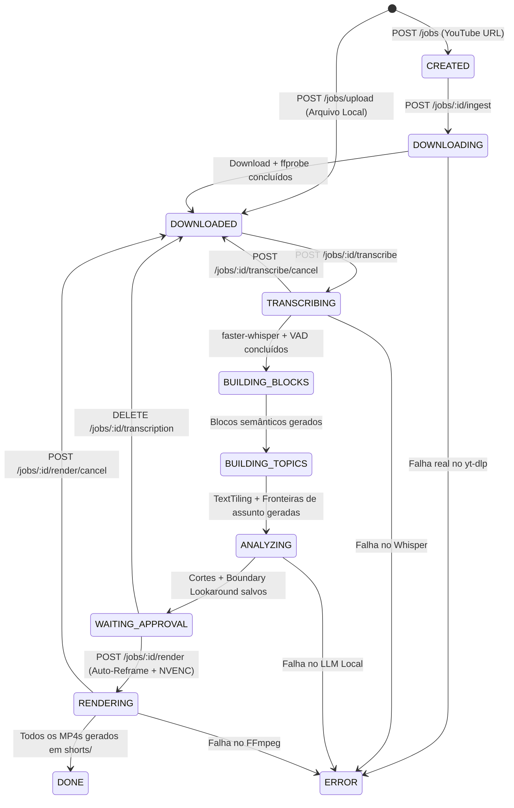

# DESIGN.md — Especificação da API e Contratos de Integração

> [!IMPORTANT]
> Este documento define o contrato oficial de integração HTTP/JSON entre o **Frontend (React + Vite)** e o novo **Backend em Python (`FastAPI`)** do **YouTube Shorts Local AI Studio**.
> Todas as rotas, métodos HTTP e formatos de resposta consumidos por [`frontend/src/api/`](./frontend/src/api) e definidos em [`shared/contracts.ts`](./shared/contracts.ts) são **100% preservados** para garantir compatibilidade imediata com a sessão de UI (`feature/frontend-liquid-glass`), enquanto novos campos e capacidades de IA local são expostos de forma estritamente aditiva.

---

## 1. Visão Geral e Padrão Arquitetural da API

- **Estilo Arquitetural:** RESTful HTTP/JSON + Multipart File Upload + HTTP Byte-Range Media Streaming (`RFC 9110` / `206 Partial Content`) + Polling de Telemetria.
- **Servidor e Runtime:** Python 3.11+ com **FastAPI** + **Uvicorn** (ASGI assíncrono).
- **Base URL Local:** `http://localhost:8000` (configurável via variável de ambiente `PORT`, padrão `8000`).
- **CORS:** Habilitado para origens locais de desenvolvimento e preview (`http://localhost:5173`, `http://127.0.0.1:5173`, `*` em ambiente local).
- **Serialização e Validação:** **Pydantic v2** com validação estrita de entrada e serialização determinística (`UTF-8`, timestamps em `ISO 8601 UTC` e tempos de mídia em segundos `float`).
- **Segurança e Autenticação:** Aplicação **100% local (Single-Tenant Desktop/Workstation)**. Não exige autenticação de usuário (JWT/OAuth) nas rotas locais; o fluxo padrão opera **100% offline/local com custo zero** via **LM Studio** (`http://127.0.0.1:1234/v1`) ou **Ollama** (`http://127.0.0.1:11434`).

### 1.1 Documentação Interativa Auto-Gerada
O FastAPI expõe automaticamente a especificação **OpenAPI 3.1.0** em tempo de execução:
- **Swagger UI Interativo:** `http://localhost:8000/docs`
- **ReDoc:** `http://localhost:8000/redoc`
- **Scalar API Reference:** `http://localhost:8000/scalar`
- **OpenAPI JSON Schema:** `http://localhost:8000/openapi.json`

---

## 2. Política de Códigos de Status HTTP e Tratamento de Erros

### 2.1 Códigos de Status HTTP Padronizados

| Código HTTP | Significado no Sistema | Quando é Retornado |
| :--- | :--- | :--- |
| `200 OK` | Sucesso síncrono | Leitura de estado, listagens, atualizações de configuração, conclusão de etapa síncrona. |
| `202 Accepted` | Processo assíncrono iniciado | Sessões de instalação/desinstalação de dependências em background (`/config/dependencies/:name/install/start` e `/uninstall/start`). |
| `206 Partial Content` | Streaming parcial de mídia | Requisições de vídeo com header `Range: bytes=start-end` em `/media/videos/:job_id` e `/media/shorts/:job_id/:file`. |
| `400 Bad Request` | Erro de validação ou pré-condição | Parâmetros inválidos (`cuts` não é array, formato inválido, lote não está aguardando aprovação, modelo sem nome). |
| `404 Not Found` | Recurso inexistente | `job_id`, `cut_id`, `batch_id`, `sessionId` ou arquivo de mídia/transcrição não encontrado no disco. |
| `409 Conflict` | Conflito de execução concorrente | Tentativa de iniciar renderização ou transcrição duplicada quando o recurso já está em uso. |
| `416 Range Not Satisfiable` | Range de bytes inválido | Header `Range` fora dos limites do tamanho físico do arquivo `.mp4`. |
| `422 Unprocessable Entity` | Falha de schema Pydantic / LLM | Payload JSON malformado ou artefato de entrada vazio. |
| `500 Internal Server Error` | Erro interno de execução | Falha em subprocesso (`FFmpeg`), erro de I/O em disco ou falha de inferência sem fallback disponível. |
| `503 Service Unavailable` | Motor de IA local inacessível | Servidor local **LM Studio** (`:1234`) e **Ollama** (`:11434`) ambos offline durante etapa de análise. |

### 2.2 Formato Padronizado de Erro (Error Envelope)

Para manter compatibilidade total com [`frontend/src/api/client.ts`](./frontend/src/api/client.ts) e com os testes de contrato existentes:

1. **Padrão Global (`jobs`, `videos`, `media`, `config/settings`, `config/tool-configs`, `config/llm-saved-prompts`, `config/ollama-models/*`):**
   Retorna sempre a chave primária `detail` (podendo incluir campos aditivos opcionais):
   ```json
   {
     "detail": "Não foi possível conectar ao LM Studio (127.0.0.1:1234) nem ao Ollama (127.0.0.1:11434). Abra o LM Studio ou Ollama com um modelo local carregado.",
     "error_code": "LOCAL_LLM_UNAVAILABLE",
     "stage": "ANALYZING",
     "recoverable": true
   }
   ```
2. **Exceções de Contrato Legado em `/config/dependencies/*`:**
   - `GET /config/dependencies/:name/instructions` quando `:name` não existe retorna `404 Not Found` com `{ "error": "Dependency not found" }`.
   - Rotas de ação em `/config/dependencies/:name/install`, `/uninstall`, `/install/start`, `/open-terminal` e `/install-sessions/:sessionId` retornam `{ "success": false, "message": "...", "error": "..." }`.

---

## 3. Políticas de Concorrência, Backpressure e Paginação

1. **Paginação:**
   - Como o sistema opera localmente sobre a biblioteca de vídeos do usuário, as rotas de listagem (`GET /videos`, `GET /videos/archived`, `GET /jobs/:job_id/cuts`, `GET /jobs/:job_id/renders`) retornam arrays completos ordenados por data de criação decrescente (`created_at DESC`) ou índice temporal (`start ASC`).
   - Suporte opcional via query params `?limit=100&offset=0` é aceito em `GET /videos` sem alterar o formato de resposta padrão (array JSON).
2. **Rate Limiting e Controle de Concorrência de Hardware (Backpressure Local):**
   - Não há rate-limit artificial nas rotas de leitura (`GET /jobs/:job_id`, `GET /jobs/:job_id/logs/:task`, `GET /media/*`) para permitir polling fluido do Frontend a cada `1500ms–2000ms`.
   - Nas rotas de processamento pesado (`POST /jobs/:job_id/transcribe`, `POST /jobs/:job_id/analyze`, `POST /jobs/:job_id/render`, `POST /jobs/:job_id/run`), o backend aplica **enfileiramento por recurso de hardware (`GPUMutex` = 1 para VRAM/Tensor Cores com `ActiveVRAMBudgetManager`; `RenderWorkerPool` = 2 para NVENC)**.
   - Logs de tarefa em memória (`task_logs`) usam um *ring buffer* limitado às últimas **400 linhas** por `(job_id, task)` para evitar crescimento de memória.

---

## 4. Máquina de Estados do Job (`JobStatus`)

Os valores de `JobStatus` são idênticos aos definidos em [`shared/contracts.ts`](./shared/contracts.ts):



---

## 5. Catálogo Completo de Endpoints

### 5.1 Health & Diagnóstico Rápido

#### `GET /health`
Verifica se o servidor FastAPI está online.
- **Response `200 OK`:**
```json
{
  "status": "ok"
}
```

---

### 5.2 Ciclo de Vida de Jobs e Ingestão (`/jobs`)

#### `POST /jobs`
Cria um novo Job a partir de uma URL do YouTube.
- **Request Body:**
```json
{
  "youtube_url": "https://www.youtube.com/watch?v=dQw4w9WgXcQ"
}
```
- **Response `200 OK`:**
```json
{
  "job": {
    "job_id": "7ca821c3e9594946b2f3131309baaac2",
    "youtube_url": "https://www.youtube.com/watch?v=dQw4w9WgXcQ",
    "status": "CREATED",
    "created_at": "2026-11-10T20:00:00.000Z",
    "updated_at": null
  }
}
```

#### `POST /jobs/upload`
Faz upload de um arquivo de vídeo local (`multipart/form-data`, campo `file`), salva no diretório de mídia configurado, extrai `video_duration_seconds` via `ffprobe` e cria o Job já no status `DOWNLOADED`.
- **Request Headers:** `Content-Type: multipart/form-data`
- **Response `200 OK`:**
```json
{
  "job": {
    "job_id": "659068ec935346d4ab4d22d82ebdc1bd",
    "youtube_url": "[Local Upload] podcast_episodio_12.mp4",
    "status": "DOWNLOADED",
    "created_at": "2026-11-10T20:01:00.000Z",
    "source_video_path": "C:/Users/lucas/Downloads/uploads/podcast_episodio_12/video.mp4",
    "source_file_name": "podcast_episodio_12.mp4",
    "video_name": "podcast_episodio_12",
    "video_duration_seconds": 2845.4
  },
  "video_path": "/media/videos/659068ec935346d4ab4d22d82ebdc1bd"
}
```

#### `GET /jobs/:job_id`
Retorna os metadados atuais do Job (`job.json`).
- **Response `200 OK`:** Objeto `Job`.
- **Response `404 Not Found`:** `{ "detail": "Job not found" }`.

#### `POST /jobs/:job_id/ingest`
Executa o download do vídeo do YouTube usando a biblioteca nativa `yt_dlp` no Python, extrai título, capítulos (`chapters`), duração exata (`video_duration_seconds`) e move o vídeo para a pasta final `{base_dir}/{video_name}/video.mp4`.
- **Response `200 OK`:**
  - **Importante:** `video_path` retorna a URL relativa de streaming HTTP (`/media/videos/:job_id`) usada pelo elemento `<video>` do Frontend, enquanto `full_path` retorna o caminho físico no sistema de arquivos:
```json
{
  "video_path": "/media/videos/7ca821c3e9594946b2f3131309baaac2",
  "metadata_path": "C:/Users/lucas/code/youtube-shorts/data/jobs/7ca821c3e9594946b2f3131309baaac2/source.info.json",
  "full_path": "C:/Users/lucas/Downloads/uploads/Meu_Video/video.mp4",
  "job_id": "7ca821c3e9594946b2f3131309baaac2",
  "status": "DOWNLOADED"
}
```
- **Response `500 Internal Server Error`:** Caso o `yt-dlp` falhe (sem criar vídeo dummy falso), atualiza o job para `ERROR` e retorna `{ "detail": "Ingestion failed: ..." }`.

#### `POST /jobs/:job_id/rename` (e alias `PUT /jobs/:job_id/rename`)
Renomeia o vídeo e move sua pasta física no disco, invalidando caches de caminho e atualizando `source_video_path` e `video_name`.
- **Nota de Compatibilidade:** O Frontend ([`frontend/src/api/jobs.ts`](./frontend/src/api/jobs.ts)) invoca `POST /jobs/:job_id/rename` e espera o objeto `Job` diretamente no topo da resposta JSON. O backend aceita tanto `POST` quanto `PUT` nesta rota e retorna o objeto `Job` diretamente.
- **Request Body:**
```json
{
  "new_name": "Entrevista Completa - Economia"
}
```
- **Response `200 OK`:**
```json
{
  "job_id": "7ca821c3e9594946b2f3131309baaac2",
  "youtube_url": "https://www.youtube.com/watch?v=dQw4w9WgXcQ",
  "status": "DOWNLOADED",
  "created_at": "2026-11-10T20:00:00.000Z",
  "updated_at": "2026-11-10T20:03:00.000Z",
  "video_name": "Entrevista Completa - Economia",
  "source_video_path": "C:/Users/lucas/Downloads/uploads/Entrevista Completa - Economia/video.mp4",
  "video_duration_seconds": 2845.4
}
```

#### `GET /jobs/:job_id/logs/:task`
Retorna as linhas de log em tempo real da tarefa (`task` $\in$ `["ingest", "transcription", "render"]`).
- **Response `200 OK`:**
```json
{
  "task": "transcription",
  "logs": [
    "[transcription] Carregando faster-whisper (large-v3-turbo, cuda, int8_float16)...",
    "[transcription] Silero VAD ativo: 142 segmentos de fala detectados",
    "[transcription] Progresso: 65% (1850.0s / 2845.4s)"
  ]
}
```

---

### 5.3 Transcrição Local GPU (`faster-whisper` + `Silero VAD`)

#### `POST /jobs/:job_id/transcribe`
Executa a transcrição local na GPU (RTX 5070 CUDA com fallback automático para CPU se a VRAM estiver ocupada), aplica filtro `Silero VAD` e filtro anti-alucinação, salva `transcription.segments.json`, `transcription.words.json`, `transcription.txt` e `transcription.vtt` em `{video_dir}/transcrições/`, atualiza `video_duration_seconds` se necessário e avança o status para `BUILDING_BLOCKS`.
- **Response `200 OK` (Compatível com [`useTranscriptionWorkflow.ts`](./frontend/src/hooks/useTranscriptionWorkflow.ts)):**
```json
{
  "transcription": "Muita gente acha que investir em renda fixa é perder dinheiro, mas deixa eu te mostrar a conta real.",
  "segments": [
    {
      "segment_id": "s1",
      "start": 0.42,
      "end": 4.18,
      "text": "Muita gente acha que investir em renda fixa é perder dinheiro, mas deixa eu te mostrar a conta real.",
      "speaker": "SPEAKER_00"
    }
  ],
  "available_formats": {
    "segments": true,
    "text": true,
    "vtt": true
  },
  "job_id": "7ca821c3e9594946b2f3131309baaac2",
  "status": "BUILDING_BLOCKS",
  "segments_count": 318
}
```

#### `POST /jobs/:job_id/transcribe/cancel`
Aciona o `cancel_token` cooperativo da transcrição ativa do Job, interrompe o generator do `faster-whisper` em `< 500ms`, libera a VRAM + `GPUMutex` imediatamente e retorna o status do Job para `DOWNLOADED`.
- **Response `200 OK`:** `{ "ok": true, "job_id": "..." }`
- **Response `404 Not Found`:** `{ "detail": "Transcription not running" }`

#### `GET /jobs/:job_id/transcription`
Lê os artefatos de transcrição já gerados para o Job em `{video_dir}/transcrições/` (com fallback de leitura em `data/jobs/:job_id/`).
- **Response `200 OK`:**
```json
{
  "transcription": "Muita gente acha que investir em renda fixa...",
  "segments": [
    {
      "segment_id": "s1",
      "start": 0.42,
      "end": 4.18,
      "text": "Muita gente acha que investir em renda fixa...",
      "speaker": "SPEAKER_00"
    }
  ],
  "available_formats": {
    "segments": true,
    "text": true,
    "vtt": true
  }
}
```
- **Response `404 Not Found`:** `{ "detail": "Transcription not found" }`.

#### `DELETE /jobs/:job_id/transcription`
Remove todos os artefatos de transcrição do Job e reseta `job.status` para `"DOWNLOADED"`.
- **Response `200 OK`:**
```json
{
  "ok": true,
  "job_id": "7ca821c3e9594946b2f3131309baaac2",
  "available_formats": {
    "segments": false,
    "text": false,
    "vtt": false
  }
}
```
- **Response `404 Not Found`:** `{ "detail": "Transcription not found" }`.

#### `DELETE /jobs/:job_id/transcription/:format`
Remove um formato específico de transcrição. Aceita os nomes canônicos enviados pelo Frontend (`:format` $\in$ `"segments" | "text" | "vtt"`) bem como os aliases (`"json" | "txt"`). Quando `:format` é `"segments"` (ou `"json"`), também reseta `job.status` para `"DOWNLOADED"`.
- **Response `200 OK`:**
```json
{
  "ok": true,
  "job_id": "7ca821c3e9594946b2f3131309baaac2",
  "available_formats": {
    "segments": true,
    "text": false,
    "vtt": true
  }
}
```
- **Response `400 Bad Request`:** `{ "detail": "Invalid format" }`.
- **Response `404 Not Found`:** `{ "detail": "Transcription not found" }`.

---

### 5.4 Blocos Semânticos, Segmentação de Assuntos e Análise por IA Local

#### `POST /jobs/:job_id/blocks`
Constrói e salva `semantic.blocks.json` agrupando segmentos por limites de frase, pausas reais do VAD, troca de locutor e marcadores de discurso.
- **Response `200 OK`:** Array de `SemanticBlock`:
```json
[
  {
    "block_id": "b1",
    "start": 0.42,
    "end": 12.85,
    "text": "Muita gente acha que investir em renda fixa é perder dinheiro, mas deixa eu te mostrar a conta real...",
    "segment_ids": ["s1", "s2", "s3"],
    "speaker": "SPEAKER_00",
    "is_topic_opener": true
  }
]
```

#### `POST /jobs/:job_id/analyze`
Prepara automaticamente os pré-requisitos (`semantic.blocks.json` e `topic.segments.json` via TextTiling contextual + capítulos do YouTube) e executa o pipeline de IA local em 3 fases (**LM Studio** ou **Ollama**):
1. Extração de cortes com arco narrativo completo (Começo, Meio e Fim) e duração média flexível (~90s).
2. Pré-filtro Top-$K$ e passe de refinamento de fronteira (**Boundary Lookaround `[-3, +3]`**).
3. Snap acústico em vale de energia RMS + zero-crossing.

- **Response `200 OK`:**
```json
{
  "cuts": [
    {
      "cut_id": "c1",
      "block_ids": ["b12", "b13", "b14", "b15", "b16", "b17"],
      "start": 142.18,
      "end": 228.64,
      "title": "A conta real da Renda Fixa contra a Inflação",
      "status": "pending",
      "score": 95,
      "hook_reason": "Abre com uma pergunta direta e contraintuitiva sobre perda de poder de compra.",
      "middle_development": "Compara o retorno líquido descontando IR e inflação real em 5 anos.",
      "end_conclusion": "Fecha com a regra prática de alocação para reserva de oportunidade.",
      "duration_seconds": 86.46
    }
  ],
  "raw_response": "[...]"
}
```

---

### 5.5 Curadoria e Edição de Cortes (`/jobs/:job_id/cuts`)

#### `GET /jobs/:job_id/cuts`
Lista os cortes salvos em `cuts.suggested.json`.
- **Response `200 OK`:** Array de `Cut`.

#### `PUT /jobs/:job_id/cuts`
Substitui/atualiza a lista de cortes do Job (usado pela UI para ajustes finos de `start`/`end`, adição manual, exclusão ou reordenação).
- **Request Body:**
```json
{
  "cuts": [
    {
      "cut_id": "c1",
      "block_ids": ["b12", "b13", "b14"],
      "start": 142.18,
      "end": 228.64,
      "title": "A conta real da Renda Fixa",
      "status": "approved"
    }
  ]
}
```
- **Response `200 OK`:** `{ "ok": true, "cuts": [...] }`.

#### `POST /jobs/:job_id/cuts/:cut_id/approve` e `POST /jobs/:job_id/cuts/:cut_id/reject`
Altera atomicamente o status de um corte específico para `"approved"` ou `"rejected"`.
- **Response `200 OK`:** Objeto `Cut` atualizado.

---

### 5.6 Renderização Vertical Inteligente (`/jobs/:job_id/render*`)

#### `POST /jobs/:job_id/render`
Inicia em background a renderização vertical (`1080x1920`, `9:16`) de todos os cortes não rejeitados (`status !== "rejected"`), executando:
- Auto-Reframe com rastreamento de rosto e fallback inteligente para cenas sem rosto (ou o preset vertical configurado: `auto_reframe`, `split_podcast`, `crop`, `zoom`, `blur`).
- Geração e queima opcional de legendas dinâmicas palavra-por-palavra (`.ass`).
- Masterização de áudio (`loudnorm` `-14 LUFS` + micro-fade `30ms`).
- Codificação via `h264_nvenc` (com fallback automático para `libx264`).

- **Response `200 OK`:**
```json
{
  "started": true
}
```

#### `POST /jobs/:job_id/render/cancel`
Cancela a renderização em andamento, mata a árvore de subprocessos FFmpeg ativos, remove arquivos `.mp4` e `.ass` parciais incompletos e retorna o Job para `DOWNLOADED`.
- **Response `200 OK`:** `{ "ok": true, "job_id": "..." }`.

#### `GET /jobs/:job_id/renders`
Lista os arquivos `.mp4` já gerados na pasta `shorts/` do vídeo.
- **Response `200 OK`:**
```json
[
  "cut_00-02-22.180_to_00-03-48.640.mp4",
  "cut_00-08-10.050_to_00-09-42.110.mp4"
]
```

#### `DELETE /jobs/:job_id/renders/:file`
Exclui um corte renderizado específico do disco.
- **Response `200 OK`:** `{ "ok": true, "file": "cut_00-02-22.180_to_00-03-48.640.mp4" }`.
- **Response `404 Not Found`:** `{ "detail": "Render file not found" }`.

#### `POST /jobs/:job_id/renders/:file/open-folder`
Abre a pasta `shorts/` no explorador de arquivos do sistema operacional.
- **Response `200 OK`:** `{ "ok": true }`.

---

### 5.7 Pipeline Completo (Modo 1-Clique para Leigos e Batch Pipeline)

#### `POST /jobs/:job_id/run`
Executa o pipeline completo de forma sequencial para um vídeo a partir da etapa em que ele estiver (`DOWNLOADING` $\rightarrow$ `TRANSCRIBING` $\rightarrow$ `BUILDING_BLOCKS` $\rightarrow$ `BUILDING_TOPICS` $\rightarrow$ `ANALYZING` $\rightarrow$ opcionalmente `RENDERING` se `include_render: true`).
- **Request Body:**
```json
{
  "include_render": true
}
```
- **Response `200 OK`:** Objeto `Job` atualizado ao final do pipeline (com `status: "DONE"` quando `include_render: true`).

#### `POST /jobs/batch/run`
Inicia o processamento em lote para múltiplos vídeos com suporte a pausa opcional para aprovação (`preApprove`).
- **Request Body:**
```json
{
  "job_ids": ["7ca821c3e9594946b2f3131309baaac2"],
  "options": {
    "transcription": true,
    "analysis": true,
    "render": true,
    "preApprove": false
  }
}
```
- **Response `200 OK`:** `{ "batch_id": "batch_1762804800000", "status": "started" }`.

#### `GET /jobs/batch/:batch_id/status`, `POST /jobs/batch/:batch_id/cancel`, `POST /jobs/batch/:batch_id/continue`
Consulta o progresso do lote (`BatchPipelineProgress`), cancela a execução (propagando o cancelamento imediatamente para a transcrição, chamada HTTP ao LLM ou renderização FFmpeg do `current_job_id` em andamento) ou retoma após a curadoria dos cortes pendentes (`pending_cuts`).

---

### 5.8 Biblioteca de Vídeos (`/videos`) e Streaming de Mídia (`/media`)

- **`GET /videos`** e **`GET /videos/archived`**: Retorna array de `VideoRecord`.
- **`POST /videos/:job_id/archive`**, **`DELETE /videos/:job_id`**, **`POST /videos/:job_id/open-folder`**: Arquiva na pasta `_archived`, remove do disco ou abre a pasta local do vídeo.
- **`GET /media/videos/:job_id`** e **`GET /media/shorts/:job_id/:file`**:
  - Suporte completo a **HTTP Range Requests (`Accept-Ranges: bytes`, `206 Partial Content`)** para seek instantâneo no player de vídeo do Frontend.

---

### 5.9 Configurações, Provedores Locais (LM Studio + Ollama) e Dependências (`/config`)

#### `GET /config`
Resumo rápido da configuração ativa (`whisper` e `llm`).

#### `GET /config/ollama-models`
Lista unificada de modelos locais disponíveis tanto no **LM Studio (`http://127.0.0.1:1234/v1/models`)** quanto no **Ollama (`http://127.0.0.1:11434/api/tags` e `/api/ps`)**, além dos modelos registrados nas configurações.
- **Response `200 OK`:**
```json
{
  "online": true,
  "configuredModel": "qwen2.5:14b",
  "models": [
    "qwen2.5:14b",
    "qwen2.5-14b-instruct",
    "qwen2.5:7b",
    "gemma3:12b"
  ],
  "catalog": [
    {
      "name": "qwen2.5:14b",
      "model": "qwen2.5:14b",
      "source": "local",
      "provider": "lmstudio",
      "installed": true,
      "running": true,
      "needsDownload": false
    }
  ],
  "localAvailable": true,
  "remoteAvailable": false
}
```

#### `POST /config/ollama-models/register` e `DELETE /config/ollama-models/:modelName`
Registra e testa um modelo local (no LM Studio ou Ollama) ou remove-o da lista. Em caso de erro de validação ou falha de teste (`400 Bad Request`), retorna `{ "detail": "..." }`.

#### `GET /config/tool-configs`, `POST /config/tool-configs`, `POST /config/tool-configs/reset`, `POST /config/tool-configs/reset/:section`, `POST /config/tool-configs/import`
Gerencia as configurações persistidas de **Whisper**, **FFmpeg** e **LLM** (`data/default_configs.json` e `data/custom_settings.json`).
- **Formato de Resposta:**
```json
{
  "source": "default",
  "defaults": {
    "whisper": { "...": "..." },
    "ffmpeg": { "...": "..." },
    "llm": { "...": "..." }
  },
  "active": {
    "whisper": { "...": "..." },
    "ffmpeg": { "...": "..." },
    "llm": { "...": "..." }
  }
}
```
- **Novos campos suportados em `ffmpeg` (retrocompatíveis):**
  - `vertical_mode`: `"auto_reframe" | "split_podcast" | "crop" | "zoom" | "blur"` (padrão: `"auto_reframe"`).
  - `burn_subtitles`: `boolean` (padrão: `true` quando `disable_subtitle` é `false`).
  - `subtitle_style`: `"word_highlight" | "sentence"` (padrão: `"word_highlight"`).
  - `normalize_audio`: `boolean` (padrão: `true`, aplica `-14 LUFS` `loudnorm`).
  - `trim_internal_silence`: `boolean` (padrão: `false`, remove pausas mortas > 1.2s dentro do corte sincronizando `.ass` e keyframes).
- **Novos campos suportados em `llm` (retrocompatíveis):**
  - `provider`: `"auto" | "lmstudio" | "ollama"` (padrão: `"auto"` — prioriza LM Studio se aberto na porta `1234`, senão usa Ollama na `11434`).
  - `lmstudio_base_url`: `string` (padrão: `"http://127.0.0.1:1234/v1"`).
  - `ollama_base_url`: `string` (padrão: `"http://127.0.0.1:11434"`).
  - `target_cut_duration_seconds`: `number` (padrão: `90`, média flexível guiada pelo fim natural do assunto).
  - `max_suggested_cuts`: `number` (padrão: `12`, teto de cortes retornados por vídeo ordenados por `score`).
  - `enable_boundary_lookaround`: `boolean` (padrão: `true`).

#### `GET /config/settings`, `POST /config/settings`, `GET /config/common-folders`, `POST /config/select-folder`
Gerencia o diretório base de mídia (`data/settings.json`), resolução de download (`1080p`, `1440p`, `4k`) e seletor nativo de pastas do sistema operacional.

#### `GET /config/llm-prompt`, `GET /config/llm-prompt/default`, `GET /config/llm-saved-prompts`, `POST /config/llm-saved-prompts`
Gerencia o prompt do sistema e templates salvos pelo usuário em `data/saved_llm_prompts.json`.

#### `GET /config/dependencies` e Rotas de Instalação (`/config/dependencies/*`)
Verifica o status de instalação de `python`, `whisper` (`faster-whisper` / `openai-whisper`), `ytdlp`, `ffmpeg`, `cuda`, `pytorch` (incluindo suporte explícito a `rtx_5000` para a **RTX 5070** com CUDA 12.8) e `ollama` / `lmstudio`.
